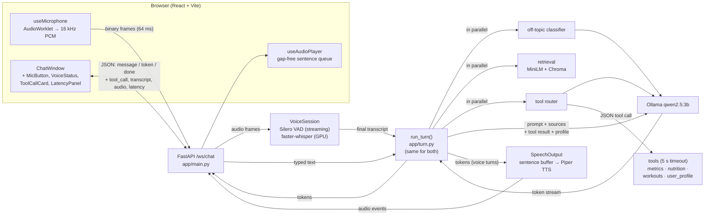
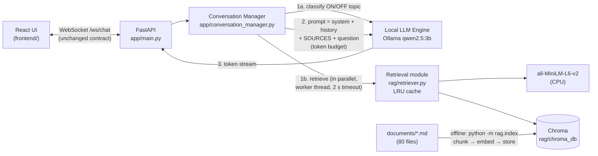

# Zor Fitness Club — Nova Assistant (Assignments 1–3: chat, RAG, voice + tools)

Nova is a fully local, streaming AI front-desk assistant and fitness coach for **Zor Fitness
Club**, a fictional gym with three branches in Islamabad and Rawalpindi. Everything runs on your
own machine: no cloud APIs and no browser speech APIs.

| Assignment | What it added |
|---|---|
| **1** — conversational core | FastAPI + WebSocket token streaming, a local `qwen2.5:3b` via Ollama, conversation memory, stages, an off-topic gate ([docs/ASSIGNMENT1_README.md](docs/ASSIGNMENT1_README.md)) |
| **2** — RAG | Answers grounded in 80 gym documents (MiniLM embeddings + Chroma), with citations (Part 2, §1–§13 below) |
| **3** — voice + tools | **Talk to Nova:** mic → Silero VAD → faster-whisper → the *same* chat pipeline → Piper TTS, sentence by sentence. **Three fitness tools** through prompt-based function calling, plus a **CRM memory** bonus (Part 1, A3.1–A3.11 below) |

- **Median ~0.8 s from the end of speech to the first audio**; every turn under 2 s, also with
  two users at once. See A3.6.
- **Voice is not a separate system:** a spoken turn calls the same `run_turn()` as a typed one, so
  it uses the same history, RAG, tools and streaming.
- **The text WebSocket contract is unchanged:** new event types are only sent to clients that
  opt in with `?extended=1`. The A1/A2 contract tests pass unmodified.
- The design log for each stage is in [PROMPTS.md](PROMPTS.md).

---

## Contents

**Part 1 — Assignment 3: voice + tools**

- [A3.1 Architecture](#a31-architecture)
- [A3.2 Model choices](#a32-model-choices)
- [A3.3 Tools and the orchestrator](#a33-tools-and-the-orchestrator)
- [A3.4 Voice pipeline](#a34-voice-pipeline)
- [A3.5 CRM bonus: remembering the member](#a35-crm-bonus-remembering-the-member)
- [A3.6 Latency benchmarks](#a36-latency-benchmarks)
- [A3.7 Concurrency](#a37-concurrency)
- [A3.8 Frontend additions](#a38-frontend-additions)
- [A3.9 API additions](#a39-api-additions)
- [A3.10 Tests](#a310-tests)
- [A3.11 Known limitations (Assignment 3)](#a311-known-limitations-assignment-3)

**Part 2 — Setup, and Assignment 2 (RAG)**

1. [Quick start (setup for all three assignments)](#1-quick-start)
2. [Architecture](#2-architecture)
3. [Document collection](#3-document-collection)
4. [Indexing pipeline: chunking, embeddings, vector store](#4-indexing-pipeline)
5. [Retrieval, grounding and visible citations (bonus)](#5-retrieval-and-grounding)
6. [Context budget](#6-context-budget)
7. [Real-time behaviour: latency, caching, concurrency, streaming](#7-real-time-behaviour)
8. [Failure handling](#8-failure-handling)
9. [Evaluation](#9-evaluation)
10. [API reference](#10-api-reference)
11. [Testing](#11-testing)
12. [Known limitations](#12-known-limitations)
13. [Project structure](#13-project-structure)

---

# Part 1 — Assignment 3: voice + tools

## A3.1 Architecture



**A typed turn** ([turn.py](backend/app/turn.py)):
1. Three steps run **at the same time** (`asyncio.gather`): the A1 **off-topic classifier**
   (LLM), A2 **retrieval** (worker thread), and the new **tool router** (LLM). The CRM profile
   is read from disk in the same `gather`.
2. If the router chose a tool, it runs with a 5 s timeout. Its result, as an inline **tool
   card** in the chat, and the member profile are added to the prompt as system messages.
3. One streamed LLM generation produces the answer, exactly as in A2 (token events, citations).

**A spoken turn** is the same `run_turn()` call. Before it, `VoiceSession` turns microphone
frames into a final transcript (VAD end-of-speech + Whisper). During it, every reply token is
also fed to `SpeechOutput`, which speaks each sentence as soon as it is complete.

## A3.2 Model choices

All measured on the development machine: i9-14900HX, **RTX 4080 Laptop (12 GB)**, 32 GB RAM, Windows 11.

| Role | Model | Why | Measured |
|---|---|---|---|
| LLM | **`qwen2.5:3b`** via Ollama (GPU), unchanged from A1/A2 | Fast first token, good instruction-following for its size, and already tuned across two assignments. A 7B model would double the generation time. | First token ~40 ms when the prompt prefix is cached; ~100–270 ms in a real turn |
| ASR | **faster-whisper `large-v3-turbo`**, forced to English, CUDA float16 (falls back to **`base.en`** CPU int8) + a **vocabulary prompt** (Nova, trainers, branches, plans) | Started as `small.en`; in a live test an accented "Hi Nova" became "Hain Allah" / "Hi Noah". Turbo = large-v3's encoder (much more robust to accents) with a small decoder, so it stays fast. The vocabulary prompt alone halved the word errors. | Word errors on 40 test sentences (clear voices): `small.en` 12–15% → `small.en` + prompt 6–9% → **turbo + prompt 4–8%**. **On the tester's real voice** (21 clips): turbo 97.5% word accuracy vs full `large-v3` 96.3% (and 2× slower); with the name/vocabulary fixes **98.8%, 20/21 sentences exact**. ~165 ms per question on GPU. |
| VAD | **Silero VAD v6** (ONNX, CPU), the copy bundled with faster-whisper | Far more robust to noise than energy thresholds or webrtcvad; tiny (~1 ms per 32 ms window); nothing extra to download | Runs per 64 ms frame in a worker thread |
| TTS | **Piper `en_US-lessac-medium`** (ONNX, CPU) | **Piper vs Kokoro:** Piper is ~40× real time on CPU with a 60 MB voice; Kokoro sounds more natural but is several times slower and much heavier. First-audio latency won. | One sentence in **~50–100 ms** |
| Embeddings | `all-MiniLM-L6-v2` (CPU), unchanged from A2 | See §4.1 | ~15 ms per query |

**Document collection and retrieval** are unchanged from Assignment 2, except two added documents
(`who_can_join_men_and_women.md`, `hours_for_men.md`; see A3.11): see §3 (the documents and
how they were made), §4 (chunking, embeddings, Chroma) and §5 (top-k = 4, threshold 0.35,
citations).

## A3.3 Tools and the orchestrator

### How prompt-based function calling works here ([orchestrator.py](backend/app/orchestrator.py))
1. **Router call.** A short system prompt lists every tool (name, description, JSON schema of
   the arguments) and 16 examples. The LLM must reply with **either `NONE` or one JSON object**
   `{"tool": "...", "arguments": {...}}`. It runs at temperature 0 and **in parallel** with the
   classifier and retrieval, so it adds almost no wait.
2. **Detection and validation.** `parse_tool_call()` extracts the JSON (tolerating ``` fences)
   and rejects unknown tools. `validate_args()` checks types, enums and required fields, accepts
   `"80"` for 80, and drops invented keys.
3. **Execution:** `asyncio.wait_for(tool.run(args, ctx), timeout=5 s)`. A timeout, a
   `ToolError` (e.g. a missing height) or a crash is turned into a short message, never an
   exception. The `user_id` comes from the server's `ToolContext`, **never from the LLM**, so one
   member can't read or change another member's data.
4. **Answer.** The result goes into the normal prompt as a `TOOL RESULT` system message
   ("these values are FINAL… don't recalculate"), and the usual streaming generation words the
   answer. In voice mode that answer is spoken.

**Why a separate router call:** with the tool list inside the 1,600-token persona prompt, the 3B
model made **0 tool calls in 7 tool requests**. It asked for numbers it already had, or refused
BMI as "math". With a router prompt whose only job is choosing a tool: **7/7 routed correctly,
0 false positives** on plan, price and off-topic questions. It is still prompt-based function
calling, just in a prompt small enough for a 3B model. Details in [PROMPTS.md](PROMPTS.md).

### The tools

| Name | Description (as given to the LLM) | Data |
|---|---|---|
| `calculate_fitness_metrics` | Calculate BMI, daily calorie needs (maintenance, loss, gain) or an estimated one-rep max from the member's numbers. | BMI + WHO category; Mifflin-St Jeor BMR × activity factor; Epley 1RM (≤ 12 reps) |
| `lookup_nutrition` | Look up calories, protein, carbs and fat for a common food (optionally for a given number of grams or servings). | [`backend/data/foods.json`](backend/data/foods.json): **42 foods**, per 100 g + a typical serving, incl. roti, daal, chana, dahi; alias + fuzzy matching |
| `workout_schedule` | Add a workout to the member's weekly schedule, list their scheduled workouts, or delete one (by id or by day). | `backend/data/workouts.json`, keyed by user ID |
| `user_profile` *(CRM bonus)* | Remember (update) or recall (get) facts about the member across visits: their name, fitness goal, injuries, preferences and last workout. | `backend/data/profiles.json`, keyed by user ID |

**Argument schemas** (JSON Schema, from the code):
```json
calculate_fitness_metrics: {"type":"object","required":["metric"],"properties":{
  "metric":{"type":"string","enum":["bmi","daily_calories","one_rep_max"]},
  "weight_kg":{"type":"number"}, "height_cm":{"type":"number"}, "age":{"type":"integer"},
  "sex":{"type":"string","enum":["male","female"]},
  "activity_level":{"type":"string","enum":["sedentary","light","moderate","active","very_active"]},
  "lifted_kg":{"type":"number"}, "reps":{"type":"integer"}}}

lookup_nutrition: {"type":"object","required":["food"],"properties":{
  "food":{"type":"string"}, "grams":{"type":"number"}, "servings":{"type":"number"}}}

workout_schedule: {"type":"object","required":["action"],"properties":{
  "action":{"type":"string","enum":["add","list","delete"]},
  "day":{"type":"string"}, "workout":{"type":"string"},
  "duration_min":{"type":"integer"}, "workout_id":{"type":"integer"}}}

user_profile: {"type":"object","required":["action"],"properties":{
  "action":{"type":"string","enum":["get","update"]},
  "name":{"type":"string"}, "fitness_goal":{"type":"string"}, "injuries":{"type":"string"},
  "preferences":{"type":"string"}, "last_workout":{"type":"string"}}}
```

### The LLM invoking each tool (real runs)
| Member says | Router output (the LLM's tool call) | Tool result | Nova's answer |
|---|---|---|---|
| 🎤 "What is my BMI if I weigh 80 kilos and I am 180 centimetres tall?" | `{"tool":"calculate_fitness_metrics","arguments":{"metric":"bmi","weight_kg":80,"height_cm":180}}` | `{"bmi":24.7,"category":"normal weight"}` | "Your BMI is 24.7, which falls within the normal weight range." |
| "I benched 80 kg for 6 reps, what's my one rep max?" | `{"tool":"calculate_fitness_metrics","arguments":{"metric":"one_rep_max","lifted_kg":80,"reps":6}}` | `{"one_rep_max_kg":96.0,"formula":"Epley"}` | "Your one rep max based on that is 96.0 kg." |
| 🎤 "How much protein is in two eggs?" | `{"tool":"lookup_nutrition","arguments":{"food":"egg","servings":2}}` | `{"food":"egg","portion":"2 x 1 large egg (100 g)","calories":155,"protein_g":13.0,…}` | "Two eggs provide about 13 grams of protein." |
| "Add leg day on Monday for 60 minutes to my schedule." | `{"tool":"workout_schedule","arguments":{"action":"add","day":"Monday","workout":"leg day","duration_min":60}}` | `{"added":{"id":1,"day":"Monday","workout":"leg day","duration_min":60}}` | "…leg day on Monday for 60 minutes [added] to your schedule." |
| "My name is Sara and my goal is to build muscle." | `{"tool":"user_profile","arguments":{"action":"update","name":"Sara","fitness_goal":"build muscle"}}` | `{"saved":{…},"profile":{…}}` | "Great to hear that, Sara! Let's focus on a balanced diet with enough protein…" |
| "How much is the Plus plan?" | `NONE` → normal RAG answer with citations | – | "The Plus plan costs PKR 16,000 per month…" (chips: plan_plus.md, …) |

🎤 = spoken through the voice pipeline. **Errors:** a missing number gives e.g. *"To calculate BMI
I need: height_cm."*, which Nova turns into a question; an unknown food gives *"'dragon steak' is
not in my nutrition database."*; a timeout gives *"The tool took too long to respond."*

## A3.4 Voice pipeline

**Input** ([voice_session.py](backend/app/voice/voice_session.py)):
- The browser's AudioWorklet ([public/mic-processor.js](frontend/public/mic-processor.js))
  resamples the mic to **16 kHz mono 16-bit PCM** and sends **64 ms binary frames** on the same
  WebSocket.
- The server scores each 32 ms window with **streaming Silero VAD**: speech starts at p ≥ 0.5,
  silence is p < 0.35, end of speech is **0.5 s of silence**, blips under 0.25 s are ignored, and
  0.3 s of pre-roll is kept.
- While the member speaks, a **partial transcript** runs every ~0.7 s in the background (live
  captions). At the end of speech the **final transcript** (Whisper, GPU) becomes a normal user
  turn, and the browser shows it as a normal user bubble.

**Output** ([speech_output.py](backend/app/voice/speech_output.py),
[sentence_buffer.py](backend/app/voice/sentence_buffer.py)):
- LLM tokens are buffered into sentences (`. ! ?`; the **first** chunk may also end at a comma
  after 40 characters, which gets audio out sooner). Markdown is stripped, and the
  `Sources:` line is never spoken.
- Each sentence is synthesized in order by Piper in a TTS thread and sent as an `audio` event
  (base64 PCM, `seq`) **while the text is still streaming**. The browser schedules each buffer to
  start exactly when the previous one ends.

**Half-duplex:** the browser only sends mic audio while the server is `listening` and nothing is
playing, so Nova never transcribes its own voice from the speakers. States shown in the UI:
`idle → listening → transcribing → thinking → speaking → listening`.

**Failure handling:** voice models missing → `voice_unavailable` toast, and text chat still
works. ASR error → toast, and listening continues. TTS error → one toast, and the full text reply
still arrives. Mic permission denied → toast. Connection lost → toast and banner, and voice mode
switches off. All of these are covered by tests.

## A3.5 CRM bonus: remembering the member

- Each browser gets a stable **user ID** (localStorage), sent as `?user_id=`.
  [`user_profile.py`](backend/app/tools/user_profile.py) stores, per user ID: name, fitness goal,
  injuries, preferences, last workout, and the **last 5 interactions**.
- The **LLM tool** saves and reads facts. **The server**, without the LLM:
  - adds the profile to every prompt (so Nova uses the name and keeps injuries in mind);
  - logs each on-topic request;
  - on a **new session of a returning member**, sends *"Welcome back, Sara! Last time you asked:
    "How much is the Plus plan?". Want to pick up from there…?"*. The greeting is **spoken once
    when voice mode starts**.
- **Voice, live:** after two text visits, a spoken *"What is my name and what is my goal?"* got
  *"Your name is Sara and your fitness goal is to build muscle."* (738 ms to first audio).

## A3.6 Latency benchmarks

[`benchmarks/voice_benchmark.py`](benchmarks/voice_benchmark.py) speaks each question with Piper,
streams it to the running server **in real time** (64 ms frames + silence, like a microphone),
and collects the server's per-turn `latency` event. Full tables:
[`benchmarks/voice_results.md`](benchmarks/voice_results.md). Times in ms:

| Scenario | ASR | Retrieval + routing | Tool | LLM 1st token | TTS 1st audio | **End of speech → 1st audio** |
|---|---|---|---|---|---|---|
| RAG question: "What time does the F-7 branch open?" | 164 | 116 | – | 235 | 127 | **812** |
| Tool: "How much protein is in two eggs?" | 168 | 289 | 0 | 109 | 79 | **758** |
| Tool: BMI (long question) | 167 | 364 | 0 | 119 | 56 | **811** |
| Tool: "Add leg day on Monday…" | 186 | 309 | 1 | 267 | 67 | **932** |
| RAG: "How much is the Elite plan?" | 132 | 106 | – | 229 | 112 | **757** |
| **1 voice user, 6 turns** | | | | | | **median 784, max 932** |
| **1 voice + 1 text user concurrently** (text first token 272–453 ms) | | | | | | **median 840, max 1,028** |
| **2 voice users concurrently** | | | | | | **median 1,205, max 1,367** |

- **Target met:** ~1 s for one user (median 0.78 s), every turn under the 2 s maximum, and
  retrieval + tools always under 0.8 s (target < 2 s). All 16 benchmark transcripts were exact.
- The larger, more accurate speech model costs ~60 ms per turn vs `small.en`; with two people
  talking at the same moment they share the GPU, so the median rises to ~1.2 s.
- "End of speech" is when the VAD decides the member stopped, which is **0.6 s after the last
  word** (the silence hangover). That wait is not included above; it is the price of not cutting
  people off mid-sentence.
- Total ≈ ASR + routing + LLM first token + time to the first complete sentence + TTS.
  **Tool turns route a little slower** (~300–400 ms), because the router has to *write* the JSON
  call (~40 tokens) rather than just `NONE`.
- **The biggest fix:** on Windows, `localhost` tries IPv6 first while Ollama listens on IPv4,
  which cost **~270 ms on every LLM request**. Using `127.0.0.1` cut the classifier from 310 to
  41 ms and the voice median from **1,318 to 737 ms**. It also speeds up A1/A2 text chat.
- The latency panel in the UI shows the same numbers for every turn, typed or spoken.

## A3.7 Concurrency

- Nothing heavy runs on the event loop: Whisper (2-thread executor, so two users can be
  transcribed at once), Piper (1 thread, ~50–100 ms per sentence), VAD, retrieval and JSON
  stores (`asyncio.to_thread`), and the LLM (async httpx; `OLLAMA_NUM_PARALLEL=4`).
- **Tested** (A3.6): voice + text and voice + voice at the same time. The text user's first
  token stays at 310–564 ms while another user talks.
- The A2 text concurrency test with voice loaded:

  | | 5 clients | 10 clients |
  |---|---|---|
  | time to first token (median / max) | **0.43 / 0.77 s** (A2: 0.84 / 1.15) | 1.68 / 2.92 s (A2: 1.34 / 2.65) |
  | `/session/new` under load | 1 ms | 2 ms |

  It's faster at 5 clients (the `127.0.0.1` fix). It's slightly slower at 10, because each
  message now makes **3** LLM calls (classifier, router, reply) and the GPU is shared.
- JSON files are written under a lock with an atomic rename, and 10 concurrent adds lose
  nothing (test). The same session in two tabs still gets the A1 `busy` error.

## A3.8 Frontend additions

The existing chat UI is **extended, not redesigned**: same layout, components, theme and socket.
The stack is React 19 + **Vite** + TypeScript + Tailwind v4 + shadcn/ui; the existing app is
Vite, not Next.js, and it was kept that way. **One new library:** `sonner` (toasts).
framer-motion and lucide-react were already used.

| New file | What it is |
|---|---|
| `public/mic-processor.js` | AudioWorklet: mic → 16 kHz int16, 64 ms chunks |
| `src/hooks/useMicrophone.ts` | getUserMedia (echo cancellation on) + the worklet |
| `src/hooks/useAudioPlayer.ts` | gap-free, in-order playback of the sentence audio |
| `src/hooks/useVoiceChat.ts` | voice mode on top of the existing socket: state, partial transcript, latency, toasts, half-duplex gate |
| `src/components/MicButton.tsx` | mic toggle next to the input (shadcn `Button`) |
| `src/components/VoiceStatus.tsx` | idle / listening / transcribing / thinking / speaking + live transcript |
| `src/components/ToolCallCard.tsx` | inline tool card: name, arguments, spinner → result (shadcn `Card`) |
| `src/components/LatencyPanel.tsx` | collapsible last-turn latency (the existing shadcn `Accordion`) |
| `src/components/ui/sonner.tsx` | shadcn Sonner wrapper in the Volt-on-Graphite theme |

| Modified file | Change |
|---|---|
| `src/types.ts` | new strictly typed event and message types (additive) |
| `src/hooks/useChatSocket.ts` | connects with `extended=1&user_id=…`; handles `tool_call`, `tool_result` and the final `transcript`; exposes `addListener`, `sendAudio`, `send` |
| `src/components/ChatWindow.tsx` | renders MicButton, VoiceStatus, LatencyPanel and the Toaster; adds a connection-lost toast |
| `src/components/MessageBubble.tsx` | one line: a message with `tool` renders a `ToolCallCard` |

## A3.9 API additions

All additive. A client that sends none of these and doesn't pass `?extended=1` gets exactly the
A2 protocol (tested).

```jsonc
// connect: /ws/chat?extended=1&user_id=<stable id>[&session_id=…]
// client -> server
{ "type": "voice_start" }  { "type": "voice_stop" }
<binary frame>  // 16 kHz mono int16 PCM, any length (the browser sends 1024 samples)

// server -> client (extended clients only)
{ "type": "tool_call",   "id": "a1b2c3d4", "name": "lookup_nutrition", "arguments": {"food": "egg", "servings": 2} }
{ "type": "tool_result", "id": "a1b2c3d4", "name": "lookup_nutrition", "ok": true, "result": {"protein_g": 13.0, …} }
{ "type": "voice_state", "state": "idle" | "listening" | "transcribing" | "thinking" | "speaking" }
{ "type": "transcript",  "text": "How much protein is in two eggs", "final": false }
{ "type": "audio",       "seq": 0, "sample_rate": 22050, "data": "<base64 int16 PCM>" }
{ "type": "audio_end" }
{ "type": "latency", "asr_ms": 93, "retrieval_ms": 287, "tool_ms": 0, "llm_first_token_ms": 124, "tts_first_audio_ms": 60, "total_ms": 654 }
{ "type": "error", "code": "voice_unavailable" | "asr_error" | "tts_error", "message": "…" }
```
A spoken turn's reply still arrives as ordinary `token` / `done` events, so the chat shows the
text while the audio plays.

## A3.10 Tests

`cd backend && python -m pytest -q`: **120 tests** (87 from A1/A2, all still passing unchanged,
plus 33 new). No Ollama or speech model is needed: the LLM, ASR, TTS and VAD are faked.

| File | What it covers |
|---|---|
| [`test_tools.py`](backend/tests/test_tools.py) | each tool (BMI, Mifflin-St Jeor, Epley, nutrition aliases, typos and servings, schedule add/list/delete, per-user isolation, 10 concurrent writes); validator; parser; **timeout** and **crash** → friendly message; router failure; a full tool turn over the WebSocket; old clients see only A2 events; CRM profile, interaction log, greeting, and the profile reaching the prompt |
| [`test_voice.py`](backend/tests/test_voice.py) | sentence splitting; a spoken turn's full event order (partials → final → thinking → tokens → audio in `seq` order → `audio_end` → latency); noise blips ignored; voice without models → clean error; TTS failure still delivers the text; audio ignored before `voice_start` |

Live checks run against the real models: `benchmarks/voice_benchmark.py`, the A2
`eval/concurrency_test.py`, `evaluation/off_topic_battery.py` (**28/30**, was 27/30), and a
real-Chromium run with a fake-microphone WAV file (mic → tool card → spoken answer, 682 ms).

## A3.11 Known limitations (Assignment 3)

1. **No barge-in.** Half-duplex: you can't interrupt Nova while it speaks (this avoids it hearing
   itself). Press the mic button to stop.
2. **One tool per turn.** "Add leg day and show my schedule" runs only the first action.
3. **A 3B model words the tool results.** The numbers come from the tool and are marked FINAL
   (1RM 6/6 correct after the fix), but a small model can still round, rephrase or (rarely)
   restate a number. It also doesn't always apply a saved injury to exercise advice.
4. **The router only uses the last exchange.** "What's my BMI?" reuses the numbers from earlier
   in the session; a very old value may be missed or reused unexpectedly.
5. **The classifier is still a 3B model:** greetings mostly pass now ("Hello", "How's your day
   going?"), but e.g. "Hey there" can still get the off-topic redirect.
6. **0.6 s end-of-speech wait** (raised from 0.5 s, which cut people off at short pauses):
   longer pauses mid-sentence still end the turn early.
7. **English only for voice** (Whisper forced to English / Piper `en_US`). Roman Urdu typed text still works as
   in A2.
8. **The user ID is per browser** (localStorage), not a login. Clearing site data starts a new
   member, and anyone using the same browser shares the profile.
9. **Without an NVIDIA GPU**, ASR falls back to `base.en` on CPU (~300 ms per question), and the
   LLM runs on the CPU too. Expect roughly 2–3 s to first audio instead of ~0.8 s.
10. **The mic resampler** uses linear interpolation without a low-pass filter. That's fine for
    speech recognition, but it's not hi-fi.
12. **Document gaps found in the live demo (fixed):** no document said men can join, or gave
    men's hours, so "plans for males?" retrieved only Ladies-Only documents (Nova implied the gym
    was women-only) and "when do the males go?" got Ramadan hours. Fixed by adding
    `who_can_join_men_and_women.md` and `hours_for_men.md` (both from the facts file) plus classifier
    examples; re-runs now answer correctly and A2's recall@4 is unchanged (20/20). The 3B model can
    still blur plan details when summarising several plans at once (e.g. saying every plan covers
    all branches; only Plus and Elite do).
11. **The first turn after a long idle can be slow:** Ollama unloads the model after 30 min and
    the GPU drops to a low-power state (measured 9.2 s once). Turning the mic on now warms
    everything in the background, which removes most of it.

---

# Part 2 — Setup, and Assignment 2 (RAG)

## 1. Quick start

### Prerequisites
- **Python 3.11+** (developed on 3.14), **Node.js 18+**, and **[Ollama](https://ollama.com)**
- About 3 GB of disk space for the LLM, the embedding model and the Python packages, plus about
  **2.7 GB for voice** (Whisper `large-v3-turbo` ~1.6 GB, Piper voice 60 MB, the CUDA libraries ~1 GB if
  you have an NVIDIA GPU)
- A microphone and Chrome, Edge or Firefox for voice mode (localhost counts as a secure
  origin, so the mic is allowed)

### 1.1 The LLM
```bash
ollama pull qwen2.5:3b
```

### 1.2 Backend + index
```bash
cd backend
python -m venv .venv
source .venv/Scripts/activate        # Windows Git Bash;  .venv/bin/activate on macOS/Linux
pip install -r requirements.txt     # includes faster-whisper, onnxruntime, piper-tts (+ CUDA libs)
cp .env.example .env                 # optional: every value has a default

python -m rag.index                  # build the vector index from ../documents (~25 s first time)

# Assignment 3: download the Piper voice (60 MB) into backend/models/piper/
python -m piper.download_voices en_US-lessac-medium --data-dir models/piper

uvicorn app.main:app --host 127.0.0.1 --port 8000
```
The first run downloads `all-MiniLM-L6-v2` (~90 MB), the Qwen2.5 tokenizer (~7 MB) and the
**faster-whisper model** (`large-v3-turbo` ~1.6 GB on a GPU, `base.en` ~140 MB on a CPU) from Hugging
Face. The Silero VAD model ships inside the faster-whisper package. After that, everything runs
offline. The startup log shows which ASR device was chosen, e.g.
`ASR ready: faster-whisper large-v3-turbo on cuda (float16)`. Without an NVIDIA GPU it falls back to
`base.en on cpu (int8)` automatically. To skip loading the speech models (text only), set
`VOICE_ENABLED=false`.

### 1.3 Frontend
```bash
cd frontend
npm install
npm run dev                          # open http://localhost:5173
```
Click **Chat with Nova**, then the **mic button** next to the text box to talk. The latency
panel above the input shows the timings of the last turn.

### 1.4 Updating the documents
Edit, add or delete files in `documents/`, then run `python -m rag.index` again from `backend/`.
Only changed files are re-embedded (see §4.4). **Then restart the backend.** The result cache is
designed to invalidate itself (§7.2, tested within one process), but in Assignment 3 a server that
was already running kept returning its old search results after a re-index from a second process,
until it was restarted.

### 1.5 Optional environment variables
| Variable | Where | Effect |
|---|---|---|
| `HF_HUB_OFFLINE=1` | backend shell | Skips Hugging Face's online update checks once the models are downloaded. Model + tokenizer loading went from **7.4 s to 0.8 s** on the test machine. Not hardcoded, because the first run needs the download. |
| `OLLAMA_NUM_PARALLEL=4` | Ollama's environment (Windows: `setx OLLAMA_NUM_PARALLEL 4`, then quit and restart Ollama) | Lets Ollama serve 4 requests at once instead of queueing them. It roughly halves the wait under load (§7.3). |
| `SIMILARITY_THRESHOLD`, `RETRIEVAL_TIMEOUT_S`, `NUM_CTX`, … | `backend/.env` | See [backend/app/config.py](backend/app/config.py). |
| `VOICE_ENABLED`, `ASR_DEVICE` (`auto`/`cuda`/`cpu`), `ASR_MODEL` (`auto` or e.g. `base.en`), `TTS_VOICE_PATH` | `backend/.env` | Assignment 3 voice settings. |
| `OLLAMA_HOST=http://127.0.0.1:11434` | `backend/.env` | The default. Keep `127.0.0.1`: `localhost` costs ~270 ms per LLM call on Windows (A3.6). |

---

## 2. Architecture



The same flow as the diagram in the assignment:
```
Web UI <--WebSocket--> FastAPI Backend <--> Conversation Manager <--> Local LLM Engine (Ollama)
                                                    |
                                                    +--> Retrieval Module (MiniLM embeddings + Chroma)
```

**One message, step by step** (Assignment 2 version; this logic now lives in
[turn.py](backend/app/turn.py), which also runs the A3 tool router in the same `gather`, see A3.1):
1. The **off-topic classifier** (an LLM call from Assignment 1, ~350 ms) and **retrieval** (~10 ms,
   in a worker thread) run **at the same time** with `asyncio.gather`. Retrieval adds about 0 ms.
2. If the classifier says OFF_TOPIC but a document matches strongly (score ≥ 0.45), the
   documents win: the question is answered (§5.4). Otherwise an off-topic message gets the
   canned redirect, exactly as in Assignment 1.
3. The prompt is assembled within the token budget (§6), and the reply is streamed token by token.

---

## 3. Document collection

**82 Markdown documents** in [`documents/`](documents/) (80 from A2 + 2 added in A3, see A3.11), 250–500 words each, ~36,000 words in total,
about the fictional **Zor Fitness Club** (F-7 Islamabad, G-11 Islamabad, Bahria Town Phase 7
Rawalpindi).

| Category | Docs | Examples |
|---|---|---|
| Membership and pricing | 10 | `plan_plus.md`, `pricing_prepaid_plans.md`, `instalments_and_late_fee.md` |
| Offers and joining | 9 | `offer_student.md`, `offer_ramadan_fit_pass.md`, `offer_azadi.md` |
| Branches and hours | 8 | `branch_bahria_rawalpindi.md`, `hours_ramadan.md`, `ladies_areas_overview.md` |
| Classes | 8 | `timetable_weekly_by_day.md`, `class_booking_rules.md`, `class_prenatal_yoga.md` |
| Trainers, staff and PT | 12 | `trainer_sana_iftikhar.md`, `staff_kamran_baig_nutrition.md` |
| Policies | 12 | `policy_freeze.md`, `policy_guest.md`, `policy_dress_code.md` |
| Facilities | 7 | `facility_pool.md`, `facility_kids_play_area.md` |
| FAQs (2 in Roman Urdu) | 8 | `faq_roman_urdu_fees_timings.md`, `faq_ladies.md` |
| Nutrition and wellness | 6 | `nutrition_sehri_iftar_tips.md`, `wellness_beginner_workout_guide.md` |

**How the documents were made**
1. **Research** ([`raw_sources/`](raw_sources/)): public pages of 14 Pakistani gyms and sources
   (Lahore, Islamabad, Rawalpindi, Karachi, Faisalabad), saved as short notes with their URLs. They
   covered price bands, admission fees, ladies' timings, freeze and refund rules, and guest
   policies. Failures are logged in [`_research_log.md`](raw_sources/_research_log.md).
2. **One source of truth** ([`facts_source_of_truth.md`](facts_source_of_truth.md)): the
   fictional gym's plans, PKR prices, branches, hours, 9 trainers, a 17-class timetable and all
   policies. It was built on the research *patterns* only; no real gym's facts are copied.
3. **Documents written from the facts file**, in our own words, with Pakistani context: PKR,
   separate ladies floors and hours, the Friday Jumu'ah break, Ramadan timings and the Ramadan
   Fit Pass, JazzCash and Easypaisa, and Roman Urdu FAQs. Each includes specific rules an LLM
   can't guess (e.g. "no guests at G-11 Mon–Fri 6–9pm", "PT is free if the trainer is more than
   10 minutes late").
4. **Consistency check** ([`eval/check_consistency.py`](eval/check_consistency.py)): every PKR
   amount and clock time in every document must appear in the facts file, and every document
   must be 250–500 words.

---

## 4. Indexing pipeline

[`backend/rag/index.py`](backend/rag/index.py) — run with `python -m rag.index [--samples 3]`.

### 4.1 Embedding model: `sentence-transformers/all-MiniLM-L6-v2`
- **Why:** small (~90 MB, 384-dimensional vectors), fast on a CPU (about 7–12 ms per query here),
  good quality for short English passages, and runs fully locally.
- **Trade-off:** it's an English model that only reads the **first 256 tokens** of a text.
  That limit decided our chunk size (§4.3).

### 4.2 Vector store: Chroma (persistent, on disk)
- **Why:** it runs locally, stores vectors **with metadata** (source file, chunk id, section,
  file hash) that we need for citations and incremental updates, persists to one folder, and
  needs no server. FAISS would need a separate metadata store and manual persistence.
- Cosine distance (`hnsw:space = cosine`), so the similarity score is `1 − distance`.
- We always pass our own vectors (`embedding_function=None`), so Chroma never downloads a model.

### 4.3 Chunking strategy and parameters
| Parameter | Value | Why |
|---|---|---|
| Split unit | Blocks at blank lines (paragraph, list or table) | Blocks are never cut mid-way, so a rule or a price row stays whole |
| Chunk size | **80–150 words** (`MIN_WORDS`, `MAX_WORDS`) | MiniLM only reads the first 256 tokens, and our Markdown averages 1.7 tokens per word. With 150–300-word chunks, **64%** of chunks were truncated when embedded; with 80–150 words + cleaning, 10% are. |
| Preferred cut | At a heading, once the chunk has ≥ 80 words | Keeps sections together |
| Overlap | The last short block (≤ 40 words) is repeated when a cut falls mid-section | Context isn't lost at the boundary |
| Prefix | Every chunk starts with `"<document title> > <nearest heading>"` | A chunk like "Late fee is PKR 1,500" still says which document and topic it belongs to |
| Tables | Each row becomes one line: `- Area: Ladies Wing; Mon–Sat: 8:00am–9:00pm; Sunday: Closed` | The 3B model misread grid tables (§12); one self-contained line per row fixed it |
| Embedding text | Markdown symbols (`**`, `\|`, `#`) removed before embedding only | Saves the 256-token budget; the LLM still sees the original text |

**Result:** 320 chunks from 80 documents, average 121 words (min 50, max 337). Most documents
give 3–5 chunks. A few very large tables stay whole on purpose and are over 150 words.

### 4.4 Re-runnable (incremental)
Each chunk stores the SHA-256 hash of its source file, plus a `CHUNKER_VERSION`. On every run:

| File state | Action |
|---|---|
| New | chunk + embed + add |
| Changed (different hash) | delete its old chunks, then chunk + embed + add |
| Deleted | delete its chunks |
| Unchanged | skip (the model isn't even loaded) |

Changing the chunking code means bumping `CHUNKER_VERSION`, which changes every hash and
re-indexes everything automatically. **Tested:** first run (80 added), a re-run with no changes
(80 unchanged, 0 embedding work), and a re-run after editing one file and deleting another
(1 updated, 1 removed, 78 untouched). See [tests/test_rag_index.py](backend/tests/test_rag_index.py).

---

## 5. Retrieval and grounding

### 5.1 Top-k and similarity threshold
- **k = 4** chunks per query (the assignment asks for at least 3).
- **Threshold = 0.35** (cosine similarity). Chunks below it are ignored. It was chosen from the
  score distribution of [`eval/test_questions.json`](eval/test_questions.json), which has 20
  answerable and 5 unanswerable questions:

| Group | Top-1 score |
|---|---|
| Answerable test questions (20) | 0.519 – 0.769 (an expected source is in the top-4 for **20/20**) |
| Off-topic (cricket, capital city, Python code) | 0.066 – 0.168 |
| Small talk ("hi", "thanks, bye") | 0.17 – 0.30 |
| Weakest answerable question seen ("Who is the head coach?") | 0.375 |
| Gym-related but **not covered** (BJJ/MMA, Lahore branch) | 0.506 – 0.520 |

0.35 sits above all off-topic and small-talk scores and below the weakest answerable one.
**Gym-related but uncovered questions can't be separated by score:** BJJ scores about the same as
real questions. So they're handled by the grounding prompt instead: *"if the sources don't
contain the answer, say our documents don't cover it."*
Reproduce the table with `backend/.venv/Scripts/python.exe eval/threshold_scores.py`.

### 5.2 Follow-up questions
"and for ladies?" means nothing on its own, since it scored only 0.31–0.36. **Rule:** a message is
embedded together with the previous user message **only if it looks like a follow-up**. That means
it's short (6 words or fewer) **and** it either starts with a connector ("and", "or", "what about",
"how about", "for", "aur"…) or refers back with a pronoun ("it", "that", "them"…). Everything else,
including short **complete** questions like "What is the guest fee?", is embedded alone.
Chunks found through a merged query are used to answer, but they can **never overrule the
off-topic classifier** (§5.4): only the message's own match can.

> **Bug found in live use and fixed.** The first version merged *every* message of 6 words or
> fewer with the previous one. In real mixed sessions, short complete questions got glued to
> unrelated earlier questions. "Is there a pool at F-7?" after a freeze question retrieved only
> freeze documents, so the model said "our documents don't cover that". Measured: 50% of merged
> queries failed, against 12% of the rest. See §9.4 for the full investigation and the before
> and after numbers.

### 5.3 Prompt template (the per-turn sources message)
```
[system]     persona + scope rules + conversation stages + grounding rules + short gym identity
             (the 3 branches, and the only 4 plans: Standard, Plus, Elite, Ladies Only)
[user/asst]  history (oldest trimmed first to fit the budget)
[system]     SOURCES -- excerpts from Zor Fitness Club's documents that best match the member's
             latest message, best match first. Use ONLY these for gym facts.
             [Source 1: plan_plus.md]
             Plus Membership Plan > Price
             ...chunk text...
             [Source 2: ...] ...
             Answer directly from these sources, with the specific facts. Tables: read each
             row on its own ... If a rule rules their case out, answer "No" + the reason. If
             they name something we don't have, say so and list what we do have. Say our
             documents don't cover that ONLY if the sources are about something else entirely.
             Don't mention file names -- the source line is added for you.
             (or the NO MATCH note / the RETRIEVAL UNAVAILABLE note, see §8)
[system]     scope reminder (Assignment 1 "sandwich")
[user]       latest message
```
- The Apex knowledge base from Assignment 1 was **removed** from the system prompt. Gym facts now
  come only from retrieved sources. That makes grounded answers genuinely different from
  ungrounded ones, and the system prompt shrank from about 2,300 to 1,559 tokens.
- The sources go **after** the history, so the system prompt + history stay identical from turn
  to turn and Ollama can reuse their cached computation.
- Grounding rules: every gym fact must come from SOURCES; never use facts about other gyms.
- **Referring back to the source:** every grounded answer ends with a short line such as
  `Sources: plan_plus.md, plan_comparison.md`. The **server** appends it as one final ordinary
  `token` event, because the 3B model put it at the start, the end, or nowhere when asked to
  write it itself. The line is kept out of the conversation history, so the model doesn't start
  copying it.

### 5.4 How retrieval fits with the Assignment 1 off-topic classifier
The classifier and retrieval run **in parallel**, so retrieval adds about 0 ms. The classifier
alone wrongly rejected real gym questions such as *"What are the timings at the Bahria branch?"*
(probably "Bahria" reads as a property company) and trainer names. **Override:** if the
classifier says OFF_TOPIC but the best chunk scores **≥ 0.45**, the question is answered from
the sources. Every clear off-topic message scored ≤ 0.32, so there is a 0.13 margin. The
off-topic battery improved while the off-topic catch rate stayed at 100% (§9.2). The classifier's
ON_TOPIC definition now also lists fees and payment methods (cash, card, JazzCash, Easypaisa),
after "Do you accept JazzCash?" was wrongly redirected in live testing (§9.4).

### 5.5 Visible citations in the chat UI (bonus)
When an answer was grounded, the chat shows the source documents as small chips under the
message. Below: a grounded answer, a rule-based "No" (both with chips), and an off-topic
question (no chips):


- **Wire format (backward-compatible):** one optional field on the existing `done` event, and
  nothing else changes:
  ```json
  { "type": "done", "stage": "information_gathering", "sources": ["plan_plus.md", "plan_comparison.md"] }
  ```
  The list holds the files of the chunks that were **actually in the prompt** after the token
  budget, deduplicated, best match first. When the answer was not grounded (no match, retrieval
  unavailable, off-topic redirect, or the reply itself says "our documents don't cover that"),
  the field is **omitted entirely**, so `done` is byte-for-byte Assignment 1's. An old frontend
  simply ignores the field.
- **Frontend:** `useChatSocket` attaches `sources` to the reply that just finished streaming;
  `MessageBubble` renders the chips (volt accent, fade-in) only when the list exists.
- **Tested:** `test_streaming_contract.py` checks the field's presence and values for grounded and
  override answers, its absence for no-match, retrieval failure and off-topic, deduplication, and
  the "don't cover" rule. It was also checked in a real browser with Playwright: 23 token frames
  gave 23 DOM updates (streaming unchanged), chips appeared for grounded answers and not for off-topic
  redirects,
  and there were no page errors.

---

## 6. Context budget

Ollama was silently running `qwen2.5:3b` at **4,096 tokens** of context (checked with
`ollama ps`); anything longer is cut from the **front**, which means the system prompt goes
first. `num_ctx = 4096` is now set explicitly on every call. Tokens are counted with
**Qwen2.5's own tokenizer**, which matched Ollama's `prompt_eval_count` within about 1%
(3,388 vs 3,381 on the worst case).

| Part | Tokens | Rule |
|---|---|---|
| Reply space (`num_predict`) | **500** | always reserved |
| System prompt | **~1,559** | fixed, **never cut** |
| Scope reminder | **~92** | fixed |
| User message | actual, **max 1,000** | beginning kept, `…[message truncated]` marker added (matters for Urdu script) |
| Sources (chunks) | **≤ 1,200** | **lowest-ranked chunk dropped first** (4 chunks usually cost 930–1,180) |
| History | whatever is left: ~600–700 with 4 chunks, ~1,800 on no match | **oldest messages dropped first** |

A typical turn: 2,770 prompt tokens + 500 reply = 3,270 of 4,096.
The API still rejects messages over 2,000 characters, as in Assignment 1.

---

## 7. Real-time behaviour

**Test machine:** Windows 11, Intel i9-14900HX, 32 GB RAM, NVIDIA RTX 4080 Laptop (12 GB).
Ollama runs `qwen2.5:3b` (Q4_K_M) on the GPU; MiniLM and Chroma run on the CPU.

### 7.1 Retrieval latency (target < 1 s)
`cd backend && python -m rag.benchmark` (25 test questions, warm rows = 3 rounds = 75 samples).
Final run: 3 October 2026, with the final code and `OLLAMA_NUM_PARALLEL=4`. The backend and the
Vite dev server were running on the same machine at the same time, so the CPU numbers are
slightly pessimistic.

| Retrieval only | Samples | Avg ms | Median ms | p95 ms |
|---|---|---|---|---|
| Cold start: load model + open index (once, at server startup) | 1 | 7,683 | – | – |
| Cold: first query after loading | 1 | 60.3 | – | – |
| Warm, cache miss: embed query | 75 | 11.69 | 11.38 | 15.16 |
| Warm, cache miss: vector search | 75 | 2.13 | 2.11 | 2.30 |
| **Warm, cache miss: total retrieval** | 75 | **14.91** | **14.17** | **21.16** |
| **Warm, cache hit** | 75 | **0.03** | **0.02** | **0.04** |

| End-to-end, same code path as the server (20 answerable questions) | Samples | Avg ms | Median ms | p95 ms |
|---|---|---|---|---|
| Retrieval (in parallel with the classifier) | 20 | 22.01 | 21.64 | 28.93 |
| Off-topic classifier (LLM call) | 20 | 362 | 359 | 385 |
| **Time to first token** | 20 | 941 | **825** | 893 |
| **Total reply time** | 20 | 1,260 | **1,169** | 1,618 |

- **Retrieval takes about 15 ms (about 70× under the 1 s target) and is 1.9% of the total reply
  time.** It overlaps the ~360 ms classifier call, so it adds about 0 ms before the first token.
  An earlier run on an otherwise idle machine measured 9.4 ms per cache miss.
- The average time to first token is above the p95 because of **one** request: the first one
  after loading (~3 s), when Ollama processes the whole system prompt for the first time. After
  that, the unchanged prefix is reused, which is why the sources go last in the prompt.
- The cold start happens once, at server startup (§1.5 cuts it with `HF_HUB_OFFLINE`).

### 7.2 Caching
Two LRU caches in [`rag/retriever.py`](backend/rag/retriever.py), both keyed on the **final text
that is embedded** (after the follow-up rule):
- `query text → embedding` (512 entries): depends only on the model, so it stays valid when
  documents change.
- `(query text, k, index version) → top-k chunks` (256 entries). `python -m rag.index` updates an
  `index_version.txt` marker whenever anything changed; the retriever reads its timestamp (one
  `stat()` call) on every request. After a re-index, old entries can never match, so **stale
  chunks are never served**, even to an already running server. Tested in
  [tests/test_rag_cache.py](backend/tests/test_rag_cache.py): a PKR 1,000 → 1,500 edit is picked up.
- A cache hit costs about 0.03 ms, compared with about 15 ms for a miss.

### 7.3 Concurrency
Retrieval runs in a worker thread (`asyncio.to_thread`), and the model loads once at startup,
so the server's event loop is never blocked. Measured with
[`eval/concurrency_test.py`](eval/concurrency_test.py) (N simultaneous WebSocket clients, each
asking a different question, timed from sending the message; a probe calls the server during
the run):

| | `OLLAMA_NUM_PARALLEL=1` (default, 1 Oct) | `OLLAMA_NUM_PARALLEL=4` (final code, 3 Oct) |
|---|---|---|
| Single user, time to first token (median) | 0.82 s | 0.79 s |
| 5 clients: time to first token median / max | 1.54 / 2.54 s | **0.84 / 1.15 s** |
| 5 clients: all replies finished | 2.85 s | **1.57 s** |
| 10 clients: time to first token median / max | 3.17 / 5.37 s | **1.34 / 2.65 s** |
| 10 clients: all replies finished | 5.59 s | **3.46 s** |
| `POST /session/new` during the load (our server only) | ~3 ms | ~3 ms |
| Ollama memory | 2.2 GB | 2.7 GB |

**Honest reading:** the server stays responsive (`/session/new` in a few ms while 10 clients
wait), but **Ollama queues generation calls**. With the default `OLLAMA_NUM_PARALLEL=1`, each
extra client waits about 0.45 s longer, because every message makes 2 LLM calls (classifier +
reply). `OLLAMA_NUM_PARALLEL=4` cuts the worst wait for 10 users by about half (5.37 s → 2.65 s) for 0.5 GB
more memory, and single-user speed is unchanged. It's set on the test machine (§1.5).

*Assignment 3 update:* re-measured with the voice models loaded and the `127.0.0.1` fix in A3.7
(5 clients: 0.43 / 0.77 s; 10 clients: 1.68 / 2.92 s, now 3 LLM calls per message).

### 7.4 Streaming is unchanged from Assignment 1
[tests/test_streaming_contract.py](backend/tests/test_streaming_contract.py) checks three paths
(grounded answer, no match, classifier override):
- the event order is `session → token × N → done`;
- every event has **exactly** Assignment 1's fields (`schemas.py` is unchanged);
- there is **one `token` event per chunk the model yields, in order**.

A real run (before the citations bonus was added):
```
0.000s <- {"type":"session","session_id":"94fb…","stage":"greeting"}
0.000s -> {"type": "message", "content": "Is there a sauna at the Bahria branch?"}
1.174s <- {"type":"token","content":"(source"}
1.184s <- {"type":"token","content":":"}
   … 25 token events, ~8 ms apart …
1.367s <- {"type":"done","stage":"information_gathering"}
```
With citations, a grounded answer ends with one extra `token` (`"\n\nSources: …"`) and `done`
carries the optional `sources` list (§5.5).

---

## 8. Failure handling

Every case is covered by [tests/test_failures.py](backend/tests/test_failures.py) and was
also checked by hand against the running server.

### 8.1 No relevant match
Retrieval works, but no chunk scores ≥ 0.35. The model gets the **NO MATCH** note: *"say our
documents don't cover that, suggest the front desk on WhatsApp, never guess a Zor fact; answer
greetings, small talk and general fitness normally."* Real reply to *"Do you have a CrossFit box
with a rig?"* (top score 0.309): **"Our documents don't cover that. You can check with the
front desk on WhatsApp (0333-5550967)."** (3/3 runs, with `OLLAMA_NUM_PARALLEL=1`; since switching
to 4 parallel slots the classifier redirects this question as off-topic instead, which is also
acceptable). No citations are sent. Counter-example: see limitation 12 (a "yes" guessed for an
equipment question).

### 8.2 Embedding or vector store failure, or timeout
Tested cases:
- the Chroma folder missing;
- the Chroma folder corrupted;
- the embedding model raising an error;
- a search stuck longer than 2 s;
- an empty index.

For each, `retrieve_context()` returns **`None` ("unavailable") within the 2 s timeout**, the
error is **logged** (`WARNING … Retrieval unavailable (RetrievalUnavailable: the index is empty
-- run python -m rag.index); replying without documents`), and the reply still streams normally.

The Apex knowledge base is gone, so in this mode the model has **no** gym facts. It gets the
**RETRIEVAL UNAVAILABLE** note: *"don't state or guess any price, time or policy; say you can't
look that up right now; point to UAN 051-111-967-348, WhatsApp 0333-5550967 or any branch
reception."*

Real reply with the index folder removed, to *"How much is the Plus membership per month?"*:
**"Sorry, I can't look that up right now. Please contact our front desk: UAN 051-111-967-348,
WhatsApp 0333-5550967, or any branch reception."** (3/3 runs). Small talk is still answered
normally. See §12 for the limitation with action requests such as freezing.

### 8.3 Context overflow
The budget in §6 guarantees the prompt always fits. The worst case was tested with the real LLM:
12 history messages (~5,300 words), the 4 largest chunks (up to 337 words) and a 3,000-word
question.
- **Prompt:** 3,388 tokens (Ollama counted 3,381) + 500 reply reserve = 3,888 ≤ 4,096. Ollama's
  log shows `truncated = 0`.
- **System prompt:** intact.
- **Question:** its beginning was kept (995 tokens) with a truncation marker.
- **Sources:** the best one was kept.
- **History:** dropped, oldest first; in this extreme case that meant all of it.

Over the WebSocket, a message over 2,000 characters gets a clear `error` event, *"That message is
too long (the limit is 2,000 characters)…"*, and the connection stays usable.

### 8.4 Other checks
- **Empty or whitespace-only messages:** a clean `bad_request` error, and the connection survives.
- **Roman Urdu and Urdu script:** both answered. "Plus plan ki fees kitni hai?" gets
  "PKR 16,000 hai" (source: `faq_roman_urdu_fees_timings.md`). Urdu script also retrieved the
  right FAQ, with a thin margin (0.416).
- **One client failing while others are connected:** one client's retrieval failure and one
  client's model crash leave the other client's stream untouched (automated test).

---

## 9. Evaluation

### 9.1 Test questions
[`eval/test_questions.json`](eval/test_questions.json) has 25 questions with their expected
source files, including 5 that the documents can't answer. Retrieval **recall@4 = 20/20**: an
expected source is in the top-4 for every answerable question.

### 9.2 Off-topic battery (Assignment 1), before and after RAG
[`evaluation/off_topic_battery.py`](evaluation/off_topic_battery.py), 30 fixed messages:

| | Assignment 1 (classifier only, KB in prompt) | Assignment 2 (KB removed, classifier + retrieval override) |
|---|---|---|
| **Clearly off-topic caught** | **10/10** | **10/10** |
| Clearly on-topic | 9/10 | 10/10 |
| Ambiguous | 5/10 | 7/10 |
| Overall | 24/30 (80%) | 27/30 (90%) |

### 9.4 Live multi-turn sessions: the refusal bug, and the before/after numbers
**Symptom:** in a live chat session, simple questions the documents answer ("How much is the Plus
plan?", "Can students get a discount?", "What is the guest fee?", "Is there a pool at F-7?") were
answered with *"Our documents don't cover that"*, one after another, with no chips. The same
questions had worked when asked one at a time.

**Investigation.** [`eval/live_session_eval.py`](eval/live_session_eval.py) replays realistic
sessions through the real WebSocket:
- the 20 answerable test questions plus 15 new realistic ones, several of them "trick" questions
  whose correct answer is a rule-based **no** (e.g. "I'm a student, can I get 25% off Elite at 8pm?");
- mixed with controls (BJJ, Lahore, off-topic, small talk);
- shuffled into sessions of 10 messages, 3 runs with different orders.

It records each reply's refusal or correctness, and joins it with the server log's embedded query,
scores and files. That showed **three separate causes**:

| # | Root cause | Evidence | Fix |
|---|---|---|---|
| 1 | **Follow-up rule merged complete short questions with the previous, unrelated message** | 32/105 queries were merged, and **50%** of them failed vs **12%** of the rest. "Do you accept JazzCash?" after a dress-code question retrieved dress-code files. "How much is the Plus plan?" after a kids'-area question gave the *family* price, PKR 13,600. | Merge only messages that look like follow-ups (§5.2) |
| 2 | **The prompt's "documents don't cover that" escape hatch** | With an **empty** history and the right source ranked first ("Is the admission fee waived on 6 months?" → `admission_fee.md`), the model still refused 3/3. Nothing told it how to answer when a rule says *no*. | Prompt: answer directly; if a rule excludes the case, say **"No" + the reason**; if they name something we don't have, say so and list what we have; "don't cover" **only** when the sources are about something else |
| 3 | **Earlier refusals in the history were copied** | With 2 refusals already in the history, "my friend did a free trial, can he come as a guest?" went from answered (2/3) to **refused 3/3** | Refused or redirected exchanges are no longer kept in the model's history (the stage badge still updates) |
| + | The classifier didn't list **payments** as on-topic | "Do you accept JazzCash?" was redirected 3/3 (retrieval 0.403, just under the 0.45 override) | Payment methods added to the classifier's ON_TOPIC definition (off-topic battery re-run: still **10/10**) |
| + | An invented "Platinum plan" price | Asked about a plan that doesn't exist, the model sometimes made up a price | The plan names are now in the 2-line gym identity: "Standard, Plus, Elite, Ladies Only, no other plans" |

**Results:** 3 runs × 35 answerable questions = 105 replies, scored by the same rules before and after:

| | Before | After |
|---|---|---|
| **Refusals on answerable questions** | **15/105 (14.3%)** | **0/105 (0%)** |
| **Correct answers** | 82/105 (78.1%) | **104/105 (99.0%)** |
| Answers with citation chips | 91/105 | 105/105 |
| BJJ / Lahore / off-topic / small-talk controls | 2/3 · 3/3 · 6/6 · 3/3 | 3/3 · 3/3 · 6/6 · 3/3 |
| Off-topic battery (classifier) | 10/10 off-topic caught | 10/10 off-topic caught |

The one remaining wrong answer is an invented Platinum price (limitation 14).

**Follow-up regression, found and fixed.** A first version of fix 1 also retried a short message
*merged with the previous one* whenever it found nothing on its own. A screenshot session showed
the problem: *"Who won the cricket World Cup?"* asked right after a guest question borrowed the
guest policy's score (0.77), overruled the classifier, and was answered with guest-policy chips.
That fallback was removed, and chunks found through any merged query can no longer overrule the
classifier (regression tests in `test_rag_prompt.py`). Re-measured after this fix (3 runs, 105
answerable replies): **0 refusals (0%)**, **103/105 correct (98.1%)**, chips on 105/105, and all
controls as expected. The 2 misses were vague answers to "Can students get a discount?" (true, but
without the 25%), with no wrong prices. The raw replies are in
`eval/live_session_before.json` and `eval/live_session_after_final.json`.

**One visible behaviour change:** questions about things we don't offer now get a grounded "No",
e.g. *"No -- We don't offer Brazilian Jiu-Jitsu or MMA classes at Zor Fitness Club"* (with the
class-list documents as chips), instead of "our documents don't cover that". Nothing is invented.

### 9.3 End-to-end examples (real replies over the WebSocket, final version)
| Question | Nova | Citation chips (`done.sources`) |
|---|---|---|
| How much is the Plus membership per month? | "The Plus membership plan costs PKR 16,000 per month at Zor Fitness Club.<br>Sources: plan_plus.md, plan_comparison.md" | plan_plus.md, plan_comparison.md |
| What are the timings at the Bahria branch? *(classifier said OFF_TOPIC; override at 0.642)* | "…6:00 AM to midnight on weekdays, and from 10:00 AM to 8:00 PM on Sundays… only the Ladies Wing is closed." | branch_bahria_rawalpindi.md, hours_all_branches.md |
| → "and for ladies?" *(follow-up)* | "…the Ladies Wing is open from 8:00 AM to 9:00 PM on weekdays, and it is closed on Sundays." | branch_bahria_rawalpindi.md, faq_ladies.md, hours_all_branches.md |
| Do you offer Brazilian jiu-jitsu or MMA classes? | "No -- We don't offer Brazilian Jiu-Jitsu or MMA classes at Zor Fitness Club." | faq_classes_and_trainers.md, timetable_weekly_by_day.md, classes_ladies.md |
| Can I bring a guest to G-11 on a weekday evening? | "No -- guests are not allowed at G-11 Monday to Friday, 6:00–9:00pm." | policy_guest.md, classes_functional_zor_circuit.md |
| Do you have a CrossFit box with a rig? | *(off-topic redirect from the classifier)* | *(none)* |

Reproduce with `backend/.venv/Scripts/python.exe eval/e2e_examples.py` while the backend is running.

---

## 10. API reference

Unchanged from Assignment 1, except for **one optional field** on `done` (citations bonus).
The Assignment 3 additions (voice, tools, latency events; opt-in with `?extended=1`) are in A3.9.

**REST:** `GET /health` → `{status, model, ollama_reachable, active_sessions}` ·
`POST /session/new` → `{session_id, stage}`

**WebSocket `/ws/chat`** (optionally `?session_id=<id>` to resume):
```json
// client -> server
{ "type": "message", "content": "What classes do you have on Tuesdays?" }
{ "type": "reset" }
// server -> client
{ "type": "session", "session_id": "...", "stage": "greeting" }
{ "type": "token", "content": "Hi" }
{ "type": "done", "stage": "information_gathering" }
{ "type": "done", "stage": "information_gathering", "sources": ["plan_plus.md", "plan_comparison.md"] }
{ "type": "error", "message": "...", "code": "bad_request" | "busy" | "llm_error" | "internal_error" }
```
- **`sources` (optional, new in Assignment 2):** the source documents the answer was grounded in,
  deduplicated, best match first. It is present **only** when the answer was grounded and is
  omitted otherwise (not `null`, not `[]`). Clients that don't know it can ignore it.
- A grounded answer's last `token` is a short `"\n\nSource(s): …"` line added by the server.
- A message over 2,000 characters gets `error` with code `bad_request` and the text *"That message is
  too long (the limit is 2,000 characters)…"*.

---

## 11. Testing

```bash
cd backend && python -m pytest -q        # 120 tests (87 A1/A2 + 33 A3), about 1 minute, no Ollama needed
```
| File | What it covers |
|---|---|
| `test_conversation_manager.py`, `test_llm_engine.py`, `test_websocket.py` | Assignment 1 (still passing) |
| `test_rag_index.py` | chunking rules, heading prefix, incremental add, update and delete |
| `test_rag_prompt.py` | follow-up rule (complete short questions embedded alone, real follow-ups merged, merged chunks never overrule the classifier), refusals kept out of history, "No + reason" prompt rule, threshold, source labels, budget |
| `test_rag_cache.py` | cache hits, re-index invalidation, cached results returned as copies |
| `test_streaming_contract.py` | WebSocket events identical to Assignment 1 in all RAG paths; the optional `sources` field only when grounded |
| `test_failures.py` | all Phase IV failure cases (§8) |
| `test_tools.py`, `test_voice.py` | Assignment 3, see A3.10 |

Evaluation scripts (need Ollama running; the WebSocket ones also need the backend):
`python -m rag.benchmark`, `eval/threshold_scores.py`, `eval/e2e_examples.py`, `eval/live_session_eval.py`,
`eval/concurrency_test.py`, `evaluation/off_topic_battery.py`, and `eval/check_consistency.py`
(which only checks the documents).

---

## 12. Known limitations

1. **The 3B model sometimes misreads correct sources.** Retrieval is 20/20, but the answer can
   still be wrong:
   - the Bahria hours table ("closed on Sundays" for the whole branch) was fixed by
     linearizing tables and adding one explicit sentence (3/5 → 5/5);
   - a Roman Urdu FAQ sentence mixing Standard and Plus prices was fixed by splitting it per
     plan (0/3 → 3/3);
   - under the extreme overflow test, it said "student discount on all plans" (it's Standard and
     Plus only) and missed the "only one discount at a time" rule in its own source.

   Fixes were made in the data. Similar slips can still happen elsewhere.
2. **With retrieval down, action requests aren't fully safe.** The price question gets the "can't
   look that up" reply 3/3, but "Can I freeze my 6-month plan?" got "Sure, I can help… confirm
   your membership number" in 2 of 3 runs. It invents no facts, but it pretends it can act. The
   Assignment 1 stage guide ("walk through freezing") wins over the per-turn note. A fixed reply
   whenever retrieval fails would guarantee safety but would also block small talk.
3. **Gym-related but uncovered questions pass the threshold** (BJJ 0.520 vs the weakest real
   question 0.519). The prompt now makes the model answer with a grounded "No -- we don't offer
   that" (§9.4). That depends on the model following the instruction (3/3 in testing).
4. **The classifier still misfires** on small talk and on Wi-Fi or bicycle-parking questions (score
   too low for the override). When retrieval is down, the override can't help at all.
5. **English embedding model:** Urdu script works only by a thin margin (0.416 vs 0.35). The model
   also once slipped a Cyrillic letter into an Urdu reply.
6. **Citations are per retrieved file, not per sentence.** The chips and the "Sources:" line list
   every file whose chunks were in the prompt, e.g. `classes_functional_zor_circuit.md` next to
   `policy_guest.md` for the guest question, even if the answer used only one of them. (The
   model placing "(source: …)" randomly was fixed by having the server add the line.)
7. **Truncated embeddings:** 10% of chunks (whole tables or rule lists) are longer than MiniLM's
   256 tokens, so their ends are invisible to retrieval. The LLM still sees the full chunk.
8. **Ollama concurrency:** calls are queued unless `OLLAMA_NUM_PARALLEL` > 1. Even then, each
   message costs 3 LLM calls since Assignment 3 (classifier, tool router, reply).
9. **In the extreme overflow case, all history is dropped** (the oldest-first rule) to keep the
   question and the best source.
10. **Sessions and the cache live in memory:** a server restart forgets conversations.
11. **Fictional data:** prices and rules are realistic for Pakistan in 2026 but invented. Contact
    numbers are fictional.
12. **The no-match path can still produce a guessed "yes".** *"Is there a treadmill with an
    incline?"* scored 0.33 (below the threshold), and the model replied *"Sure, we have treadmills
    with incline settings"* despite the no-match note. That's plausible, but it's not in the
    documents. Questions about common gym equipment are most at risk.
13. **The classifier's verdicts shift slightly with `OLLAMA_NUM_PARALLEL`.** With 4 parallel slots,
    *"Do you have a CrossFit box with a rig?"* is redirected as off-topic, where it passed before.
    That's the classifier being non-deterministic under parallel batching, not a retrieval issue.
14. **Invented details for things that don't exist.** In the live evaluation, 1 of 105 answers
    gave a made-up price for a non-existent "Platinum" plan, even though the prompt lists the only
    four plans. Every other answer (104/105) was correct (§9.4).

---

## 13. Project structure

```
documents/                 82 gym documents (the corpus)
raw_sources/               research notes from public Pakistani gym pages + _research_log.md
facts_source_of_truth.md   the fictional gym's facts; every document must match it
backend/
  app/                     FastAPI app, conversation manager (RAG integration, budget), prompts, LLM engine
    turn.py                one turn, shared by typed and spoken messages (A3)
    orchestrator.py        tool router, argument validation, timeout, tool-result message (A3)
    tools/                 calculate_fitness_metrics, lookup_nutrition, workout_schedule, user_profile (A3)
    voice/                 vad.py, asr.py, tts.py, sentence_buffer.py, voice_session.py, speech_output.py (A3)
  data/                    foods.json (42 foods); workouts.json + profiles.json created at runtime (git-ignored)
  models/piper/            the Piper voice (git-ignored; see §1.2)
  rag/
    store.py               paths, embedding model, Chroma, index version marker
    index.py               offline indexing pipeline (python -m rag.index)
    retriever.py           retrieve(query) + LRU caches
    benchmark.py           latency benchmark (python -m rag.benchmark)
    chroma_db/             the vector index (git-ignored; rebuilt by rag.index)
  tests/                   120 tests
benchmarks/                A1 LLM benchmark + A3 voice_benchmark.py / voice_results.md
eval/                      test questions, threshold scores, e2e examples, concurrency test, consistency check
evaluation/                Assignment 1 off-topic battery (+ results.md with before/after runs)
frontend/                  React + Vite UI (A3: public/mic-processor.js, hooks/useMicrophone|useAudioPlayer|useVoiceChat)
docs/                      Assignment 1 README and testing notes
VIVA_NOTES.md              design decisions in plain words + the prompts used (A1/A2)
PROMPTS.md                 Assignment 3 build log: each stage's purpose, decisions and measurements
```
