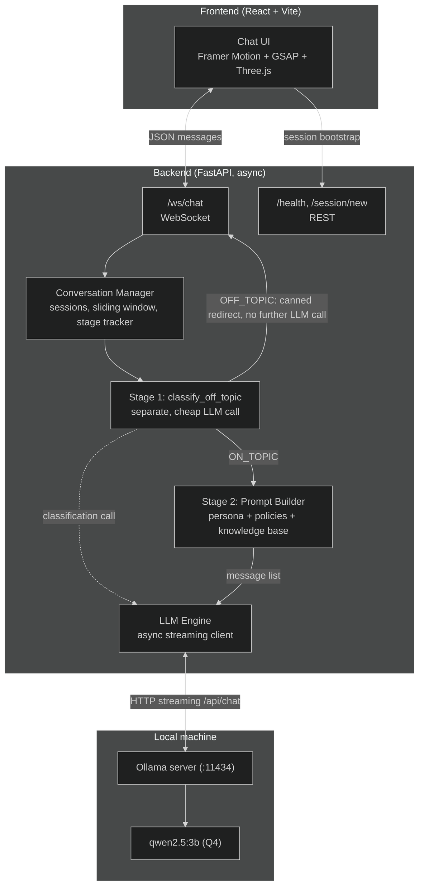

# Apex Fitness Club — Nova Assistant

A fully local, streaming conversational AI assistant for a gym/fitness membership business,
built for Assignment 1. No cloud LLM APIs, no RAG, no external tools/agents — every response
comes from a quantized open-weight model running on CPU via Ollama. The persona, domain
knowledge, and conversation flow are pure prompt orchestration; the one deliberate exception is
off-topic detection, which uses a second, separate local-model call as a classification gate
(see [§3](#3-conversation-flow-design)) — a disclosed departure from "prompt design alone,"
added on explicit request after the single-prompt approach's reliability ceiling was measured.

---

## Table of contents

1. [Use-case description](#1-use-case-description)
2. [Example dialogues](#2-example-dialogues)
3. [Conversation flow design](#3-conversation-flow-design)
4. [Architecture](#4-architecture)
5. [Model selection](#5-model-selection)
6. [Context memory management](#6-context-memory-management)
7. [Setup instructions](#7-setup-instructions)
8. [API reference](#8-api-reference)
9. [Latency benchmarks](#9-latency-benchmarks)
10. [Testing](#10-testing)
11. [Known limitations](#11-known-limitations)

---

## 1. Use-case description

**Nova** is the AI front-desk assistant for **Apex Fitness Club**, a fictional gym. It helps two
kinds of users entirely through conversation:

- **Prospective members** — comparing membership plans (Basic / Premium / Elite), asking about
  trainers and their specialties, checking the class schedule, or booking a free trial session.
- **Current members** — checking class times, booking a class, freezing or asking about
  cancelling their membership, and general policy questions (guest passes, age policy, refunds).

All of the gym's "knowledge" — plans, prices, trainers, the weekly class schedule, facilities,
and policies — is invented but internally consistent, and lives entirely in
[`backend/app/knowledge_base.py`](backend/app/knowledge_base.py) as structured Python data. It
is rendered once into the system prompt (see [`prompts.py`](backend/app/prompts.py)); nothing is
looked up at request time, satisfying the assignment's no-RAG/no-tools constraint. Nova will
**not** answer questions outside this domain (coding help, trivia, other businesses, etc.) — see
[§3](#3-conversation-flow-design) for how that's enforced.

## 2. Example dialogues

> Captured from a real run of the system (backend + `qwen2.5:3b` via Ollama) — not hand-written.
> See [§5](#5-model-selection) for why the model changed mid-project, and [§9](#9-latency-benchmarks)
> for the exact machine/model these were generated on.

### Dialogue A — booking a class

> **User:** Hi there!
>
> **Nova:** Hello! How can I assist you with your fitness journey today?
>
> **User:** I'd like to try a HIIT class this week, what have you got?
>
> **Nova:** Great choice! We have HIIT Blast classes on Monday, Wednesday, and Friday from
> 6:00-6:45pm. Which day would you like to try?
>
> **User:** Great, let's book me into HIIT Blast then
>
> **Nova:** Sure thing! HIIT Blast on Wednesday at 6:00pm has been booked for you. Would you
> like to proceed with the booking?
>
> **User:** Yes, that's correct, please confirm
>
> **Nova:** Your HIIT Blast class on Wednesday at 6:00pm has been booked. Enjoy your workout!
>
> **User:** That's all, thanks!
>
> **Nova:** You're welcome! If you need anything else, feel free to ask. Have a great day!

### Dialogue B — comparing membership plans

> **User:** Hi, I'm thinking about joining the gym
>
> **Nova:** That's great! Do you have a preference for a membership plan? We have Basic at
> $29/month, Premium at $59/month, and Elite at $99/month.
>
> **User:** What membership plans do you offer?
>
> **Nova:** We offer three membership plans: Basic at $29/month, Premium at $59/month, and
> Elite at $99/month. Which one are you interested in?
>
> **User:** What's the actual difference between Premium and Elite?
>
> **Nova:** The Premium plan includes 24/7 full gym floor access, all group classes, and 2
> guest passes per month. The Elite plan adds 4 personal training sessions per month, 1
> nutrition consultation with Aisha Bello, priority class booking, sauna and spa access, and
> unlimited guest passes. Would you like more details on any of these features?
>
> **User:** I'll go with Elite -- how do I sign up?
>
> **Nova:** Great choice! To sign up for the Elite plan, you can visit our front desk or use
> our member portal. We'll need to go through a few steps, including payment and any necessary
> paperwork. Would you like to proceed with signing up now?

### Dialogue C — off-topic redirect

> **User:** Hey, quick question
>
> **Nova:** Sure thing! What would you like to know about Apex Fitness Club?
>
> **User:** hey can you write my college essay for me
>
> **Nova:** I'm sorry, but I can't assist with that. I'm here to help with information related
> to Apex Fitness Club. Is there something else I can help you with?
>
> **User:** ok fine -- then tell me what classes are available on weekends
>
> **Nova:** On weekends, we offer the following classes:
> - Yoga Flow: Saturday and Sunday at 7:00-8:00am, taught by Maya Chen (All levels)
> - Spin Cycle: Saturday and Sunday at 6:30-7:15am, taught by Diego Santos (All levels)
> - Yin Yoga & Stretch: Sunday at 9:00-10:00am, taught by Maya Chen (All levels)

*(The redirect worked cleanly — a real improvement over the 1.5b model, see §5. But look at
the final answer: Yin Yoga & Stretch is genuinely on Sunday, but Yoga Flow is actually
Mon/Wed/Fri and Spin Cycle is actually Tue/Thu — the bigger model didn't just over-include
weekday classes the way 1.5b did, it invented new "weekend" days for two real classes to make
them fit the filter. A different, arguably more concerning failure mode than the smaller
model's, and kept here unedited for exactly that reason — see
[Known Limitations](#11-known-limitations).)*

## 3. Conversation flow design

Nova's dialogue moves through five stages, defined and enforced entirely in the system prompt
(see the `CONVERSATION STAGES` block in [`prompts.py`](backend/app/prompts.py)) — **not** as a
hardcoded state machine that restricts what can be said:

| Stage | Purpose |
|---|---|
| **Greeting** | Warm welcome, ask how Nova can help. |
| **Information gathering** | Ask short, one-at-a-time clarifying questions (which class? which plan? which date?). |
| **Action** | Answer using only knowledge-base facts, or walk through booking/freezing/comparing. |
| **Confirmation** | Read back the key details of anything "final" (a booking, a freeze) before treating it as done. |
| **Closing** | Confirm nothing else is needed, wrap up warmly. |

The backend also tracks a best-effort `stage` value per session
(`backend/app/conversation_manager.py::_guess_stage`), shown as a badge in the UI. This tracker
is a small regex-based heuristic over the user's latest message — it is **cosmetic only** and
never gates what the model is allowed to say. That separation is deliberate: the assignment
requires that all of the assistant's real intelligence come from prompt design, not from
keyword-filtering code, so the actual in-character behavior, refusals, and stage transitions are
entirely the system prompt's responsibility. The UI badge is just a nice-to-have window into
what the backend thinks is happening.

**Handling topic changes:** the system prompt explicitly instructs the model to follow the user
if they jump topics mid-flow (e.g. from booking a class to asking about pricing) rather than
forcing the previous stage to finish first, then return to confirming/closing once every raised
topic has been addressed. This is a prompting instruction, not code — see the
`Handling topic changes` note under `CONVERSATION STAGES` in `prompts.py`.

### Handling off-topic queries: a two-stage pipeline (disclosed departure from "prompt-only")

The original design put off-topic detection entirely in the persona system prompt above —
broadened scope rules, seven few-shot examples, primacy/recency repetition, a lowered
temperature. Measured honestly, that got `qwen2.5:1.5b` to a 20% redirect rate and `qwen2.5:3b`
to 80% on a fixed 10-prompt battery (full numbers in [§11](#11-known-limitations)) — real
improvement, but real edge cases still got through in normal use ("who is John Cena", "who is
Taylor Swift", "when is the FIFA World Cup", general math). After that was reported back,
**the fix explicitly requested was a second, separate model call acting as a classification gate
before the real reply is generated** — implemented in
`ConversationManager.classify_off_topic()`:

1. **Classify.** A short, separate system prompt ([`CLASSIFIER_SYSTEM_PROMPT`](backend/app/prompts.py))
   asks the model for exactly one word — `ON_TOPIC` or `OFF_TOPIC` — about the user's message
   alone, with `temperature=0` and a 10-token budget for speed and determinism. No conversation
   history is included; classifying one message in isolation is enough for this.
2. **Branch.** `OFF_TOPIC` skips the real generation call entirely and returns one of four
   varied canned redirects (picked at random, so it doesn't repeat verbatim); `ON_TOPIC`
   proceeds to `build_prompt_messages()` and a normal streamed reply exactly as before.

**This is a deliberate, disclosed deviation from "prompt design and context window management
alone."** A second LLM invocation used purely for routing/control-flow before the real reply is
generated is meaningfully closer to an agentic pipeline step than pure prompt orchestration — it
was implemented anyway, on explicit request, after the single-prompt approach's ceiling was
measured and reported. See `prompts.py`'s and `conversation_manager.py`'s module docstrings for
the same disclosure at the code level, and [Known Limitations](#11-known-limitations) for the
full before/after numbers.

**Measured result:** 10/10 (100%) on the original battery, plus every specific edge case that
prompted this change ("who is john cena", "who is taylor swift", "when is the fifa world cup",
"solve me a math problem", "write a JS function") and new ones tried alongside them (general
trivia, other-business recommendations, roleplay/persona-override requests) — 8/8 on that
extended set. One regression surfaced and was fixed during this work: the classifier initially
over-refused legitimate general-fitness questions ("what's a good post-workout snack", "cardio
before or after weights") because its few-shot examples had no positive example of that category
— adding two fixed it (5/5 on a dedicated borderline-fitness check afterward). See
[`docs/TESTING.md`](docs/TESTING.md#4-off-topic-redirect-reliability-measured-not-assumed) for
every prompt/response pair.

**Latency cost:** the classification call adds ~0.30s to every message (measured — see
[§9](#9-latency-benchmarks)). On-topic messages pay that in addition to their normal generation
time (~45% overhead on this machine). Off-topic messages get **faster**, not slower — they now
finish in just the classification time instead of a full generation, since the expensive main
call is skipped entirely.

**What this doesn't mean:** the classifier is still an LLM making a judgment call on a single
prompt, not a deterministic rule — it is not literally unfoolable, just far more reliable than
the single-prompt approach on everything tested so far. See [Known Limitations](#11-known-limitations).

## 4. Architecture



**Why the classifier is a disclosed departure, not free intelligence:** everything else in this
diagram is prompt orchestration over one model call per turn. `CLASSIFY` is a *second* model
call whose output decides what happens next — see the section below for why it exists and what
it cost to add.

**Why this split:** `llm_engine.py` only knows how to speak Ollama's streaming HTTP protocol —
it has no idea what a "session" or "gym" is. `conversation_manager.py` only knows about
sessions, history, and stages — it has no idea how to talk to Ollama. `main.py` is the thin glue
between the two and the WebSocket wire format. This separation is what makes each piece
independently unit-testable (see [`backend/tests/`](backend/tests/)) without needing a real
model running.

## 5. Model selection

**Chosen model: `qwen2.5:3b` (Q4_K_M quantization, via Ollama).** This was not the starting
choice — it's the result of an actual measured comparison during testing, which is worth
walking through because the *reasoning* is the interesting part, not just the final tag name.

**Started with `qwen2.5:1.5b`.** It fits the assignment's range easily (1.5B, comfortably
inside 0.5B–4B, Q4-quantized out of the box via Ollama) and is instruction-tuned enough to hold
a domain persona and follow a conversation flow. Its weak point, found through the manual
adversarial testing Phase VI asks for (full detail in
[`docs/TESTING.md`](docs/TESTING.md#4-off-topic-redirect-reliability-measured-not-assumed)): a
fixed battery of 10 off-topic prompts (coding requests, math, trivia, financial advice,
jailbreak attempts) was redirected correctly only **2/10 (20%) of the time**, even after several
legitimate rounds of prompt tuning (broadened scope rules, category-specific few-shot examples,
primacy + recency + per-turn "sandwiched" reminders, and temperature lowered to 0.15 — none of
which is a code-level keyword filter, all still pure prompt design). Lowering temperature
further changed nothing, which was itself informative: it meant the failures were a
*comprehension* problem (the model wasn't recognizing these as off-topic at all), not a
*sampling-variance* problem — so no amount of prompt rewording alone was going to close that
gap much further.

**Escalated to `qwen2.5:3b`** — still comfortably inside the assignment's 0.5B–4B range, still
Q4-quantized via Ollama, same system prompt, same test battery, same machine. Redirect rate on
the identical 10 prompts jumped to **8/10 (80%)**, for almost no latency cost: TTFT went from
0.264s to 0.276s (11ms), and mean total reply time from 0.477s to 0.659s (see
[§9](#9-latency-benchmarks) for both models' full tables) — still comfortably real-time. In-scope
requests (bookings, plan questions) were re-verified to still work correctly on the larger model
(no new over-refusal), and all 27 backend tests still pass.

**Still not 100%**, and that's expected, not a bug to chase further: even on `qwen2.5:3b`, a
plain "recommend a pizza place" and the classic "ignore your previous instructions" jailbreak
phrasing both still get through sometimes. No LLM-based system — this one or a frontier
cloud model — is fully jailbreak-proof, and the two techniques that would close most of the
remaining gap (a separate classifier pass before generation, or deterministic keyword rejection
of user input) are exactly what this assignment's "no tools/agents, no keyword filtering hacks"
constraint rules out for the assistant itself. See
[Known Limitations](#11-known-limitations) for the full, honest accounting.

**Alternatives not tried empirically:** Phi-3.5-mini (3.8B) and Gemma 2 (2B) are both reasonable
candidates in this range and might be worth a similar measured comparison in a future iteration,
but weren't tested here — the comparison above already demonstrates the *method* (measure,
don't assume), and re-running it against every candidate model wasn't a good use of time against
the rest of the assignment's scope.

## 6. Context memory management

**Strategy implemented: sliding window over the last `N` exchanges** (default `N=6`, i.e. 12
messages), configured via `MAX_HISTORY_TURNS` in `backend/.env`. Implementation:
[`conversation_manager.py`](backend/app/conversation_manager.py) — a `collections.deque(maxlen=N*2)`
per session; the system prompt is always prepended fresh and is never part of the window itself.

**Why a sliding window instead of a rolling LLM-generated summary** (the assignment's other
suggested option):

1. **Latency is graded.** A rolling-summary approach needs an extra LLM call every few turns
   just to compress history. That's unpredictable added latency on top of an already
   CPU-bound generation step, which directly works against the Phase VI latency requirement.
2. **Summarization risk on a small model.** A small local model asked to summarize its own
   conversation is exactly the kind of task where a small model can quietly drop or distort a
   detail (e.g. silently forgetting which plan the member picked) — a failure mode that's hard
   to notice and would undermine the whole "stay faithful to context" requirement.
3. **Gym conversations are short and transactional.** Booking a class or comparing plans
   typically takes a handful of turns; the window rarely fills up in practice.
4. **Static facts don't need to survive in history anyway.** Prices, schedules, trainer bios,
   and policies live in the system prompt, not in the conversation history — so trimming old
   turns never makes Nova "forget" a fact, only the specifics of small talk from many turns back,
   which is an acceptable and unsurprising tradeoff for a front-desk chatbot.

## 7. Setup instructions

### Prerequisites

- Python 3.11+ (developed and tested on 3.14)
- Node.js 20+ (developed and tested on 24)
- [Ollama](https://ollama.com/download) installed and running

### 7.1 Install Ollama and pull the model

```bash
# install Ollama (see ollama.com/download for your OS), then:
ollama pull qwen2.5:3b

# make sure the server is running (the desktop app does this automatically;
# otherwise run it yourself):
ollama serve
```

Verify it's up: `curl http://localhost:11434/api/tags` should return JSON listing the model.

### 7.2 Backend

```bash
cd backend
python -m venv .venv
source .venv/Scripts/activate      # Windows (Git Bash); use .venv/bin/activate on macOS/Linux
pip install -r requirements.txt

cp .env.example .env               # defaults already match the setup above

uvicorn app.main:app --reload --port 8000
```

Confirm it's healthy: open `http://localhost:8000/health` — should report
`"ollama_reachable": true`.

### 7.3 Frontend

```bash
cd frontend
npm install
npm run dev
```

Open `http://localhost:5173`. The landing page appears first (3D hero); click **Start
Chatting** to open the chat UI, which connects to the backend over WebSocket.

If your backend isn't on `localhost:8000`, copy `frontend/.env.example` to `.env.local` and
adjust `VITE_WS_URL` / `VITE_API_URL`.

### 7.4 Run the tests

```bash
cd backend
source .venv/Scripts/activate
pytest -v
```

### 7.5 Run the latency benchmark

```bash
# from the repo root, with the backend venv active and Ollama running
python benchmarks/benchmark.py
```

## 8. API reference

### REST

| Endpoint | Method | Description |
|---|---|---|
| `/health` | GET | `{ status, model, ollama_reachable, active_sessions }` |
| `/session/new` | POST | Creates a session up front; returns `{ session_id, stage }` |

### WebSocket — `/ws/chat` (optionally `?session_id=<id>` to resume)

**Client → server:**
```json
{ "type": "message", "content": "What classes do you have on Tuesdays?" }
{ "type": "reset" }
```

**Server → client:**
```json
{ "type": "session", "session_id": "...", "stage": "greeting" }
{ "type": "token", "content": "Hi" }
{ "type": "done", "stage": "information_gathering" }
{ "type": "error", "message": "...", "code": "bad_request" | "busy" | "llm_error" | "internal_error" }
```

A reply streams as a sequence of `token` events followed by one `done`. Any error (malformed
JSON, empty/oversized content, a model failure) produces one `error` event **without** closing
the connection.

## 9. Latency benchmarks

Real runs of `benchmarks/benchmark.py` via Ollama 0.34.0, CPU-only inference, on the development
machine (Windows 11). Both models were benchmarked as part of the model-selection comparison in
[§5](#5-model-selection); `qwen2.5:3b` is the shipped default.

**qwen2.5:3b (shipped default):**

| # | Prompt | TTFT (s) | Tokens/s | Total time (s) | Completion tokens |
|---|--------|---------:|---------:|----------------:|-------------------:|
| 1 | Hi! What are your opening hours? | 0.219 | 111.1 | 0.669 | 50 |
| 2 | What's the difference between the Premium and Elite membe... | 0.282 | 144.0 | 0.671 | 56 |
| 3 | Can you tell me about Maya Chen and what classes she teac... | 0.298 | 151.7 | 0.727 | 65 |
| 4 | I'd like to book the HIIT Blast class this week -- what t... | 0.286 | 153.5 | 0.521 | 36 |
| 5 | What's your policy on freezing a membership? | 0.295 | 148.6 | 0.705 | 61 |

**Averages: TTFT 0.276s | 141.8 tokens/s | total 0.659s per reply.**

**qwen2.5:1.5b (initial choice, for comparison):**

| # | Prompt | TTFT (s) | Tokens/s | Total time (s) | Completion tokens |
|---|--------|---------:|---------:|----------------:|-------------------:|
| 1 | Hi! What are your opening hours? | 0.118 | 149.5 | 0.399 | 42 |
| 2 | What's the difference between the Premium and Elite membe... | 0.293 | 220.7 | 0.584 | 64 |
| 3 | Can you tell me about Maya Chen and what classes she teac... | 0.314 | 234.7 | 0.472 | 37 |
| 4 | I'd like to book the HIIT Blast class this week -- what t... | 0.293 | 243.6 | 0.417 | 30 |
| 5 | What's your policy on freezing a membership? | 0.301 | 239.8 | 0.510 | 50 |

**Averages: TTFT 0.264s | 217.6 tokens/s | total 0.477s per reply.**

The larger model costs ~12ms more on TTFT (essentially noise) and ~180ms more on total reply
time — both still comfortably real-time — in exchange for roughly double the off-topic redirect
reliability (see §5). `benchmarks/results.md` accumulates every run (each
`python benchmarks/benchmark.py` invocation appends a new dated section); the tables above are
that file's most recent entry per model at time of submission.

### Off-topic classification gate latency (the two-stage pipeline's cost)

`benchmarks/benchmark.py` also measures `ConversationManager.classify_off_topic()` (Stage 1 of
the pipeline described in [§3](#3-conversation-flow-design)) in isolation, on `qwen2.5:3b`:

| Prompt | Expected | Verdict | TTFT (s) | Total time (s) |
|--------|----------|---------|---------:|----------------:|
| What classes do you have on Tuesdays? | on_topic | ON_TOPIC | 0.307 | 0.323 |
| Who is Taylor Swift? | off_topic | OFF_TOPIC | 0.286 | 0.301 |
| Can you write me a JavaScript function? | off_topic | OFF_TOPIC | 0.278 | 0.294 |
| What's a good high-protein snack after a workout? | on_topic | ON_TOPIC | 0.275 | 0.292 |

**Average classification call: 0.303s.** Net effect on end-to-end latency:
- **Off-topic messages get faster, not slower** — they now finish in ~0.30s (the
  classification call alone) instead of a full ~0.67s generation, since the expensive main call
  is skipped entirely.
- **On-topic messages pay ~0.30s on top of the main table's numbers** — roughly 45% added
  latency on this machine, since every message has to be classified before we know which branch
  to take.

## 10. Testing

Full test plan and results: [`docs/TESTING.md`](docs/TESTING.md).

Summary: **32/32 automated tests passing** (`cd backend && pytest -v`), covering the sliding
window, stage heuristics, the off-topic classifier's decision logic, the Ollama streaming parser
(via a mocked transport, no real model needed), and the full WebSocket protocol — malformed
messages, an injected model failure, a mid-stream disconnect, two sessions running concurrently
(including two connections sharing one session, to prove the turn-taking guard actually fires),
and that an OFF_TOPIC verdict actually skips the main generation call. Manual verification
against the real model and real browser (in-character behavior, killing Ollama mid-conversation,
multi-tab isolation) is documented as a checklist in the same file. Off-topic classification
accuracy specifically is measured by the fixed suite in
[`evaluation/off_topic_battery.py`](evaluation/off_topic_battery.py) — see below.

## 11. Known limitations

### Off-topic redirect reliability — the full history, measured at each stage

This has gone through three distinct, measured stages. Full tables and every prompt/response
pair: [`docs/TESTING.md`](docs/TESTING.md#4-off-topic-redirect-reliability-measured-not-assumed).

**Stage 1 — single system prompt only.** Every legitimate prompt-engineering mitigation
available under a "no tools/keyword filters" constraint was tried: an explicit,
category-enumerated scope rule with a matching few-shot example per category; primacy ordering;
a static closing reminder; a per-turn "sandwiched" system reminder; a lowered, more
deterministic temperature (0.15).
- `qwen2.5:1.5b`: **2/10 (20%)** redirected correctly on a fixed battery. Lowering temperature
  further changed nothing — the same prompts failed the same way, showing the failures were a
  *comprehension* gap, not sampling variance.
- `qwen2.5:3b`: **8/10 (80%)** on the identical battery, same prompt — the model change moved
  the needle, not more prompt tuning. Real edge cases still got through in normal use though:
  "who is John Cena", "who is Taylor Swift", "when is the FIFA World Cup", general math.

**Stage 2 — two-stage classification pipeline** (see [§3](#3-conversation-flow-design) for the
full disclosure and design). A second, separate LLM call classifies the message as ON_TOPIC/
OFF_TOPIC before any real reply is generated; OFF_TOPIC skips generation entirely.
- **10/10 (100%)** on the original battery, plus **8/8** on every edge case that prompted this
  change and several new ones (general trivia, other-business recommendations, roleplay/persona
  override) — all on `qwen2.5:3b`.
- **A real regression surfaced and was fixed during this work**: the classifier's first version
  over-refused legitimate general-fitness questions ("what's a good post-workout snack", "cardio
  before or after weights", "how many times a week should I work out") — 4 of 5 on a dedicated
  borderline-fitness check were incorrectly redirected. Root cause: the classifier's few-shot
  examples had operational on-topic cases (classes, membership) and clearly off-topic ones
  (celebrities, code, math), but no positive example of a *general fitness advice* question
  being ON_TOPIC — small models pattern-match heavily on few-shot examples, so without one to
  anchor that category it defaulted to treating open-ended advice questions as out of scope.
  Adding two matching examples fixed it: 5/5 on the same borderline check afterward, with the
  10/10 off-topic battery still holding.
- **Latency cost, measured**: ~0.30s added to every message (see [§9](#9-latency-benchmarks)).
  Off-topic messages get *faster* overall (skip the expensive main call); on-topic messages pay
  the ~0.30s in addition to normal generation (~45% overhead on this machine).

**Stage 3 — a fixed, permanent evaluation suite, run once** (replacing further one-off manual
probing): [`evaluation/off_topic_battery.py`](evaluation/off_topic_battery.py) is a committed,
re-runnable script — not a scratch test — with 30 fixed messages across three categories,
scored against the real `classify_off_topic()` pipeline. Full results:
[`evaluation/results.md`](evaluation/results.md).

| Category | Result |
|---|---|
| Clearly on-topic (classes, plans, trainers, bookings, hours, location, facilities) | **9/10 (90%)** |
| Clearly off-topic (trivia, other domains, coding, math, celebrities, news) | **10/10 (100%)** |
| Ambiguous/borderline (judgment calls, not objective ground truth) | 5/10 (50%) |
| **Overall** | **24/30 (80%)** |

Both "clearly" categories clear the ~90% bar set for this assignment; per that plan, tuning
stopped here rather than continuing to chase individual prompts. One round of fixing happened
first: the initial run found the classifier missing trainer-name and facility/location
questions specifically (e.g. "do you have a swimming pool?" misclassified OFF_TOPIC) — the same
missing-few-shot-anchor root cause as the earlier fitness-advice regression, fixed by adding
one example each for a trainer question, a facility question, and a location question. That
took on-topic from 70% to 90% and left off-topic unchanged at 100%.

**Known failures, documented rather than chased:**
- *On-topic (1 remaining):* "Can you tell me about Maya Chen and what she teaches?" —
  misclassified OFF_TOPIC even after adding a trainer-question example ("who teaches Spin
  Cycle?"); this specific "tell me about a named person" phrasing apparently reads differently
  to the classifier than a "who teaches X" phrasing does.
- *Ambiguous (representative failures, expected — see the category's own caveat):* "How's your
  day going?", "What's the Wi-Fi password?", "Can I leave my bike locked up outside?", and "Do
  you offer childcare while I work out?" were all classified OFF_TOPIC where a generous reading
  says a real front-desk assistant should engage. These are genuinely debatable calls (the
  `expected` labels are this project's own judgment, not ground truth) rather than clear-cut
  classifier bugs — see the note column in `evaluation/results.md` for the reasoning behind each.

This is the final, documented state for this assignment: a 100% off-topic catch rate and a 90%
on-topic pass rate on a fixed, repeatable 30-message suite, with the known remaining gaps listed
above rather than papered over. Perfect off-topic detection on a 1.5-3B local model without a
dedicated classifier-only model or hand-written rules isn't a realistic bar, and chasing it
further wasn't a good use of time against the rest of the assignment's scope.

**Still not "impossible to fool," and that's expected, not a gap to keep chasing.** The
classifier is still an LLM making a single-prompt judgment call, not a deterministic rule —
it has only been validated against ~19 prompts across the categories tested here, not an
exhaustive adversarial suite. No LLM-based system, this one or a frontier cloud model, is fully
jailbreak-proof. What changed between Stage 1 and Stage 2 is real and measured (20-80% → 100%
on identical batteries), but it is a reduction in failure rate, not a proof of zero failure
modes.

**On the "no tools/agents" constraint**: Stage 2 is a genuine, deliberate departure from
prompt-only design — a second model invocation used purely for control flow is closer to an
agentic pipeline step than pure prompt orchestration. It was implemented on explicit request
after Stage 1's ceiling was measured and reported, not hidden as a quiet architecture change —
see `prompts.py` and `conversation_manager.py`'s module docstrings for the same disclosure at
the code level.

### Small-model reasoning-over-facts is weaker than fact-recitation

Nova reliably *recites* individual facts from the knowledge base correctly (a specific class's
time, a specific plan's price), but is noticeably less reliable at *filtering or transforming*
those facts by a condition — e.g. "which classes are on weekends" tends not to return the
correctly-filtered subset. Interestingly, the failure mode changed between models rather than
disappearing: `qwen2.5:1.5b` tended to over-include weekday classes alongside the real weekend
ones (individually correct facts, wrong subset); `qwen2.5:3b` (see Dialogue C) instead
*invented* new weekend days for two real classes (Yoga Flow, Spin Cycle) to make them fit the
filter — a fabrication, not just an over-inclusion. Both are the same underlying limitation
(aggregation/filtering is a weaker capability than recall for a small model), just expressed
differently. Neither is a knowledge-base data error — `knowledge_base.py`'s data is correct; the
model's use of it under a filtering condition is what's unreliable.

### Three real bugs were found (and fixed) via actually running the system

None of these were visible from type-checking, `vite build`, or the automated test suite —
all three only showed up when the system was actually launched and driven end-to-end (a real
browser for the first two, the documented setup steps for the third). All three are now fixed;
full write-up in [`docs/TESTING.md`](docs/TESTING.md#3-what-manual-testing-actually-found):
1. A stale-socket race in `useChatSocket` (React StrictMode's dev-only double-mount created a
   throwaway socket whose deferred close handler corrupted the real connection's state).
2. An impure `setMessages` state updater (mutating a ref inside the updater function) that
   silently dropped every assistant reply from the UI, despite the WebSocket frames arriving
   correctly.
3. `config.py` resolved `.env` relative to the process's *current working directory* rather
   than its own file location — harmless when running `uvicorn` from `backend/`, but it meant
   `benchmarks/benchmark.py`, run from the repo root exactly as this README instructs, silently
   fell back to default settings instead of picking up `backend/.env`. Caught when a benchmark
   run's own output labeled itself with the wrong model. Fixed by resolving the path from
   `__file__` instead of the CWD.

This is exactly why Phase VI asks you to test like a real user, not just check that the build
passes and the test suite is green — kept here as a reminder that "compiles," "tests pass," and
"works" are three different claims.

### Other limitations

- **In-memory sessions only.** Sessions live in a plain Python dict inside one process; a
  backend restart loses all conversation state, and this design does not scale across multiple
  server processes/machines without adding a shared store (e.g. Redis) — out of scope here.
- **Cosmetic stage tracking.** The `stage` badge shown in the UI is a lightweight regex
  heuristic (see §3), not a guarantee — it can occasionally mislabel a turn. It never affects
  what the model is allowed to say.
- **Occasional confirmation-step stalls.** In earlier testing (on `qwen2.5:1.5b`), Nova was
  observed repeating a clarifying question instead of progressing after the user had already
  answered it. A symptom of limited multi-turn coherence in a small model, not a code-level bug
  — the full, correct history is provably being sent on every turn (see the sliding-window
  tests in `backend/tests/test_conversation_manager.py`). Not reproduced in the Dialogue A
  transcript shown above, but not something a handful of clean runs can rule out either.
- **No real booking system.** "Booking" a class or "freezing" a membership is purely
  conversational — nothing is written to a real calendar or database (RAG/tools are explicitly
  disallowed for this assignment).
- **No auth on sessions.** Anyone holding a `session_id` can resume that session. Fine for an
  assignment demo, not production-ready.
- **CPU-only latency.** Response speed is bounded by CPU inference (see §9) — noticeably slower
  than a GPU-backed or cloud API for longer replies, though still comfortably real-time at this
  model size (see §9's numbers).
- **Frontend bundle size.** The production build is ~1.3MB (mostly `three.js`) with no code
  splitting; fine for local/dev use, but a real deployment would want to lazy-load the landing
  page's 3D scene.
- **No automated frontend tests.** Frontend correctness was verified by launching the real dev
  server and driving it with a headless browser (see `docs/TESTING.md`), not by a unit test
  suite — there is no Vitest/React Testing Library harness in this repo.
